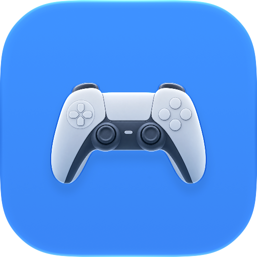

<div align="center">



# Single Sense 🎮

**Make your DualSense yours — straight from your Mac.**

Colours, triggers, rumble, even the controller's touchpad.
No PlayStation required.

</div>

---

## What you can do

### 🌈 The light bar, your way

Pick a solid colour, let it breathe slowly, or run a rainbow at 60 frames per second. There are ready-made palettes (PlayStation blue, cyberpunk cyan, neon magenta, gold) and a hex field too, if you already know the exact shade you want.

Two automatic modes that earn their keep day to day:

- **Battery gauge** — the light shifts green to red as the charge drops, and pulses when it's nearly out
- **Trigger reactive** — the colour follows how hard you squeeze L2 or R2

### 🎵 Sync with your music

**Music Sync** has its own section in the sidebar and its own switch, because it isn't a lighting effect — it drives three separate parts of the controller, and you choose which ones. It follows whatever your Mac is playing: Spotify, Apple Music, a browser tab, a game. The source doesn't matter.

**The light bar**, if you let it. While that's on, the music takes the bar over from the lighting mode; turn it off and your static colour, rainbow or breathing stays exactly as it was while the music drives only the rest.

| Style | How it looks |
|---|---|
| **Spectrum** | Red on bass, green on mids, blue on treble |
| **Colour Pulse** | Your chosen colour breathing with the volume |
| **Hue Sweep** | Bass-heavy music runs warm, bright music runs cool |
| **Beat Flash** | Dark between beats, lighting up on each one |

**The five player LEDs**, as a meter — filling from the left, growing outward from the centre, or flashing on the beat. Leave it on *Fixed Pattern* and the row keeps the player number you set in Lightbar.

**The rumble motors**, if you want to *feel* the music: bass goes to the heavy motor on the left, treble to the light one on the right. The intensity slider is a ceiling, and the music decides how much of it gets used moment to moment. It ships off, because continuous rumble drains the battery noticeably faster.

> The first time, macOS will ask for **System Audio Recording** permission. Single Sense uses Apple's native Core Audio Process Taps to listen to the system mix directly — no screen or video recording permission is needed.

### 🔊 The controller as a speaker

Switch on **Controller Speaker** and whatever your Mac is playing moves to the DualSense: its built-in speaker, or headphones plugged into its jack. The sound is moved, not copied — the Mac goes quiet while it's on and comes back the moment you switch it off.

- **Speaker** gets a mono mix of both channels, so nothing panned hard left goes missing
- **Headphones** in the controller's jack get full stereo; plug or unplug them and the sound follows
- Its own volume slider, on top of the Mac's

It needs a **USB cable**: over Bluetooth macOS doesn't see the controller as a sound device. It uses the same **System Audio Recording** permission as Music Sync.

### 🎯 Adaptive triggers

The best part of the DualSense. Build whatever feel you want:

- **Rigid resistance** — a wall starting wherever you choose
- **Weapon** — slack at first, then resistance, then a crisp break
- **Vibration** — the trigger buzzes, with adjustable frequency and strength
- **Slope** — resistance builds as you press deeper
- **Machine gun** — rapid recoil pulses
- **10-zone curve** — a graph where you draw the resistance point by point

There are presets to get going quickly: Desert Eagle, sniper rifle, shotgun, bow and arrow, ABS brake, mechanical mouse click.

And the **Dyno Test**: hold a trigger and watch the colour and rumble respond to your finger pressure live. Handy for feeling out what each setting does before you save it.

### 🖱️ The touchpad as a Mac trackpad

Yes, you can drive the cursor with the controller's touchpad.

| Gesture | What it does |
|---|---|
| One finger | Move the pointer |
| Tap | Click |
| Two fingers | Scroll |
| Two-finger tap | Right click |
| Press the pad | Click (right click with two fingers down) |
| Press and drag | Select |

It ships off, and needs **Accessibility** permission — that's what macOS requires before an app can move the cursor.

### 📊 Dashboard and sensors

The dashboard shows the whole controller on screen: buttons lighting up, sticks moving, triggers with their pressure as a percentage, real battery level and how it's connected.

There's also a **motion** tab, with the gyroscope in degrees per second and the accelerometer in G, read straight from the controller using its own factory calibration.

### 💾 Profiles

Save whole combinations — lighting, triggers, rumble — and switch between them in one click. Six come built in: PlayStation Classic, FPS, Racing, Rainbow, Battery Saver and Night City.

Everything is reachable from the menu bar item too, which displays the live battery percentage and charging status at a glance without opening the window.

---

## Getting started

You'll need a Mac running **macOS 15 (Sequoia)** or later, with Xcode installed.

```bash
git clone https://github.com/ry-diffusion/SingleSense.git
cd SingleSense
open "Single Sense.xcodeproj"
```

Then hit **Run** (⌘R). Prefer the terminal?

```bash
xcodebuild -project "Single Sense.xcodeproj" -scheme "Single Sense" -configuration Release build
```

Connect the DualSense over **USB** or **Bluetooth** — both work, and the app figures out which one on its own. It supports the standard DualSense and the **DualSense Edge**, including the back paddles.

### About the permissions

A couple of features ask the system for permission the first time:

| Feature | Permission | Why |
|---|---|---|
| Music Sync | System Audio Recording Only | Uses Core Audio Process Taps to read the system mix without screen capture |
| Trackpad | Accessibility | Required to move the cursor and click |

One caveat: the app is signed locally (ad-hoc), so macOS may ask again after each rebuild. With an Apple developer account that stops happening.

---

## For anyone digging into the code

It's a plain Xcode project — one app target and one unit-test target, no dependencies:

```bash
xcodebuild -project "Single Sense.xcodeproj" -scheme "Single Sense" build   # build
xcodebuild -project "Single Sense.xcodeproj" -scheme "Single Sense" test    # run the test suite
```

Signing is set to **Sign to Run Locally** (ad-hoc), so it builds on a clean machine with no developer account. Set your team in *Signing & Capabilities* if you want a stable signature.

Talking to the controller is done over raw HID, following the Linux kernel driver (`hid-playstation.c`) and `dualsensectl` as the reference for the packet format. The test suite has **110 tests** checking, byte by byte, what goes out to the controller — offsets, enable bits, checksum, the encoding of every trigger effect, sensor calibration and the trackpad gestures.

```
Sources/SingleSense/
├── App/         entry point and menu bar
├── Models/      configuration and state types
├── Services/    HID driver, audio and lighting engines, trackpad
└── Views/       the interface
Tests/SingleSenseTests/
Resources/Info.plist
```

---

## Credits

Built on the DualSense community's reverse engineering work — in particular the Linux kernel's [`hid-playstation`](https://github.com/torvalds/linux/blob/master/drivers/hid/hid-playstation.c) driver, [`dualsensectl`](https://github.com/nowrep/dualsensectl) and [`DualSense-Windows`](https://github.com/Ohjurot/DualSense-Windows).

An independent project, not affiliated with Sony Interactive Entertainment. PlayStation and DualSense are trademarks of Sony.
